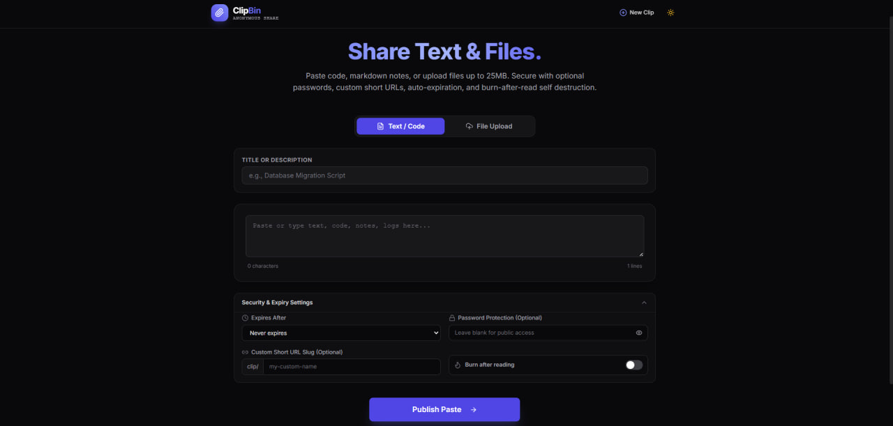
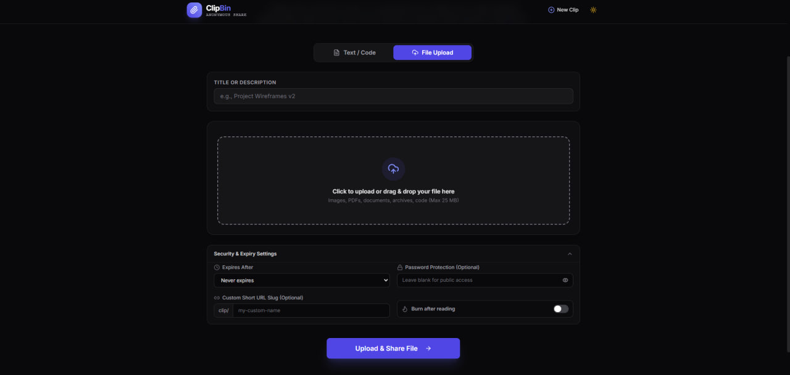
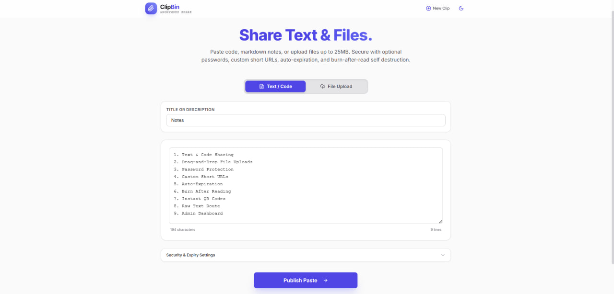
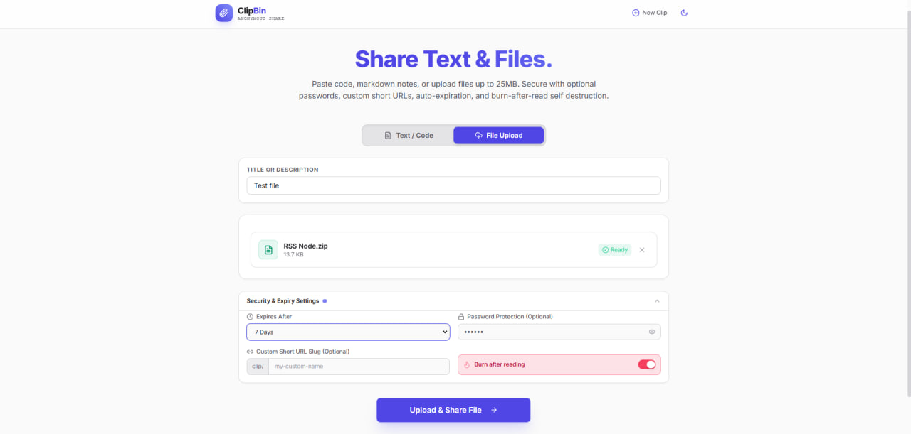
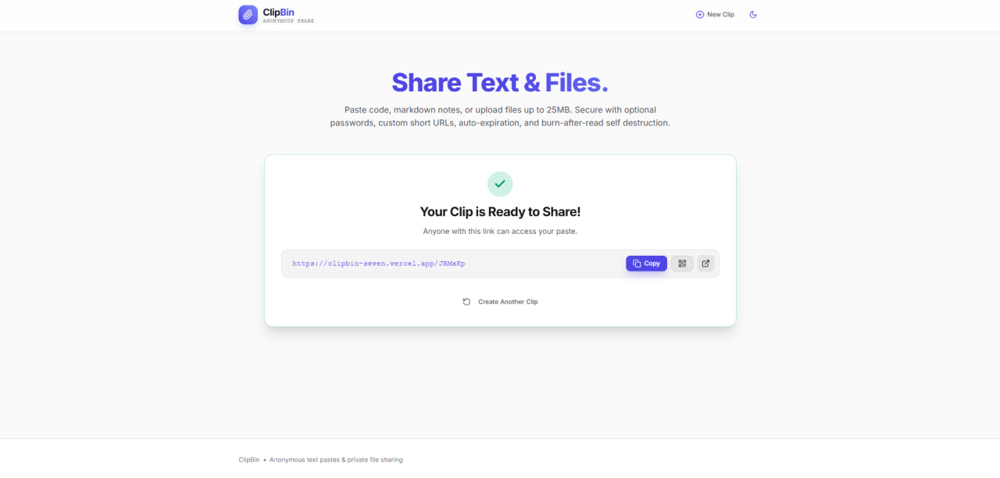
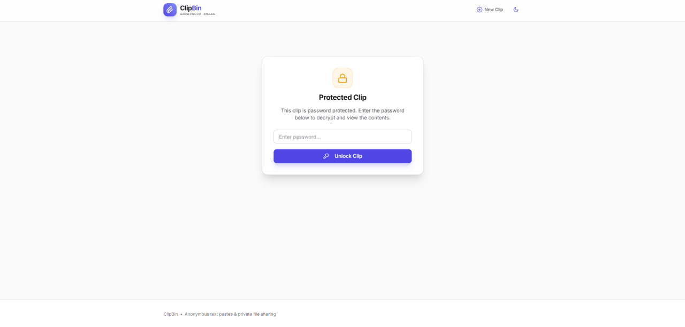
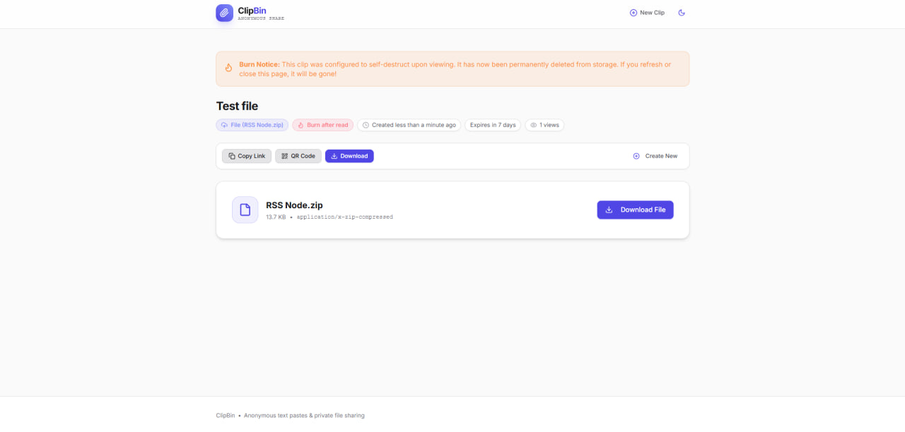
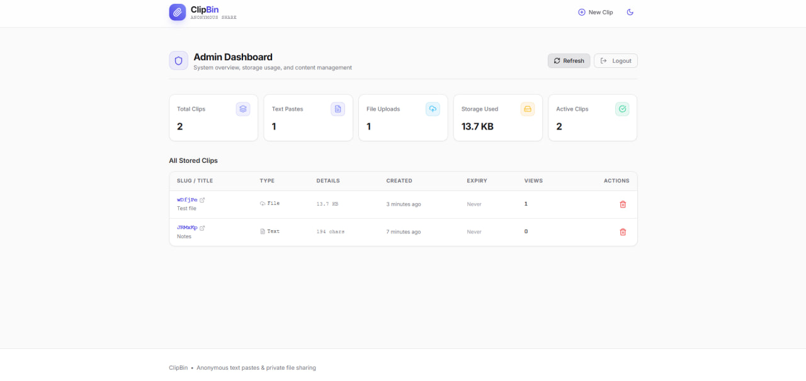

# 📎 ClipBin

A modern, fast, anonymous pastebin and private file sharing web application built with **Next.js 14**, **Supabase (PostgreSQL + Storage)**, and **Tailwind CSS**.

---

## ✨ Features

- **Text & Code Sharing**: Fast, clean monospace formatting with copy tools, character & line counts, and light/dark theme support.
- **Drag-and-Drop File Uploads**: Upload files up to 25MB (images with preview, PDFs, archives, docs). Executable scripts and binaries (.exe, .sh, .bat) are blocked.
- **Password Protection**: Optional bcrypt-encrypted password gate before viewing or downloading.
- **Custom Short URLs**: Automatically generated 6-character clean slug or custom alias.
- **Auto-Expiration**: Set retention from 1 hour up to 30 days, or never.
- **Burn After Reading**: Self-destructing pastes/files that automatically purge from database and storage after the first view.
- **Instant QR Codes**: Scan with mobile devices directly from the UI.
- **Raw Text Route**: Access pastes via `/[slug]/raw` for `curl` or plain viewing.
- **Admin Dashboard**: Accessible at `/admin` via `ADMIN_SECRET_KEY` with storage metrics, active clip counts, and one-click deletion.
- **Serverless & Free-Tier Ready**: Keepalive cron and expiry cleaner via `vercel.json` to avoid Supabase inactivity pauses.

---

## 🚀 Getting Started

### 1. Prerequisites

- Node.js 18+ (tested on Node v22)
- A free account on [Supabase](https://supabase.com)
- A free account on [Vercel](https://vercel.com) (for deployment)

### 2. Supabase Setup

1. Create a new project in [Supabase](https://supabase.com).
2. Go to the **SQL Editor** in your Supabase dashboard and execute the script in [`supabase/schema.sql`](./supabase/schema.sql).
3. Go to **Storage** → create a bucket named `clips`. Keep it **Private** (signed download URLs are generated on demand).
4. Go to **Project Settings** → **API** and copy your `Project URL`, `anon public` key, and `service_role` key.

### 3. Environment Variables

Create a `.env.local` file in the root directory:

```env
# Supabase Credentials
NEXT_PUBLIC_SUPABASE_URL=https://your-project.supabase.co
NEXT_PUBLIC_SUPABASE_ANON_KEY=your_anon_key
SUPABASE_SERVICE_ROLE_KEY=your_service_role_key

# Admin Secret Key (used to access /admin)
ADMIN_SECRET_KEY=your_secure_admin_key_here

# App URL
NEXT_PUBLIC_APP_URL=http://localhost:3000

# Vercel Cron Secret
CRON_SECRET=your_secure_cron_secret
```

### 4. Run Locally

```bash
npm install
npm run dev
```

Open [http://localhost:3000](http://localhost:3000) in your browser.

---

## 🛠 Project Structure

```
ClipBin/
├── supabase/
│   └── schema.sql                # Complete SQL schema & RLS policies
├── src/
│   ├── app/
│   │   ├── page.tsx              # Home / creation page
│   │   ├── layout.tsx            # Root layout with Header/Footer
│   │   ├── [slug]/
│   │   │   ├── page.tsx          # Clip viewing page
│   │   │   └── raw/route.ts      # Raw plain text / file route
│   │   ├── admin/page.tsx        # Admin management portal
│   │   └── api/
│   │       ├── clips/            # Create, view & download pastes
│   │       ├── upload/           # File upload handler
│   │       ├── admin/            # Admin stats & listings
│   │       └── cron/             # Auto-cleanup & keepalive
│   ├── components/
│   │   ├── ui/                   # Reusable UI atoms (Button, Input, Modal, Textarea)
│   │   ├── layout/               # Header & Footer
│   │   ├── create/               # CreateForm, TextEditor, FileDropzone, OptionsPanel
│   │   ├── view/                 # PlainViewer, FileViewer, PasswordGate, ShareToolbar
│   │   └── admin/                # AdminStats, AdminClipTable, AdminLogin
│   ├── lib/
│   │   ├── supabase/             # Browser & Service-role clients
│   │   ├── clips.ts              # DB queries & mutations
│   │   ├── storage.ts            # Bucket upload, delete & signed URLs
│   │   ├── slugs.ts              # Custom & random slug generators
│   │   ├── password.ts           # Bcrypt hashing & verification
│   │   ├── expiry.ts             # Date calculations & formatting
│   │   ├── mime.ts               # File restrictions & size formatting
│   │   └── ratelimit.ts          # IP-based rate limiting
│   └── types/
│       └── clip.ts               # Core TypeScript definitions
└── vercel.json                   # Cron schedule configurations
```

---

## 📸 Screenshots & Overview

### 1. Paste & Code Creation (Dark Mode)
Monospace editor with character & line counters, custom slug alias, and expandable security & auto-expiry settings.



---

### 2. Drag & Drop File Uploads (Dark Mode)
Upload images, documents, and archives up to 25MB with instant client-side validation and file size formatting.



---

### 3. Light Theme Support
Seamless theme switching with full contrast and typography adaptation across all devices and views.



---

### 4. Advanced Security & Burn-After-Reading (Light Mode)
Configure custom expiration (1 hour to 30 days), optional password protection with show/hide toggle, and one-time self-destructing burn links.



---

### 5. Instant Share Links & QR Codes
Generated short links with one-click copy, QR code modal for mobile scanning, and direct open preview.



---

### 6. Password Protection Gate
Protected clips are shielded behind an access gate until unlocked with the correct decryption key.



---

### 7. File Viewer & Burn Notice
Clean file card with metadata, burn notice alert banner, and direct browser attachment download button.



---

### 8. Admin Moderation Dashboard
Protected administrative control panel at `/admin` displaying real-time clip counts, total storage usage, and one-click clip management.



---

## ☁️ Deployment to Vercel

1. Push your repository to GitHub.
2. Import the project into [Vercel](https://vercel.com).
3. Set your environment variables in Vercel (*Project Settings → Environment Variables*):
   - `NEXT_PUBLIC_SUPABASE_URL`
   - `NEXT_PUBLIC_SUPABASE_ANON_KEY`
   - `SUPABASE_SERVICE_ROLE_KEY`
   - `ADMIN_SECRET_KEY`
   - `NEXT_PUBLIC_APP_URL`
   - `CRON_SECRET`
4. Deploy! Vercel crons in `vercel.json` will automatically schedule background expiry cleanup (`/api/cron/cleanup`) and database keepalive pings (`/api/cron/keepalive`).